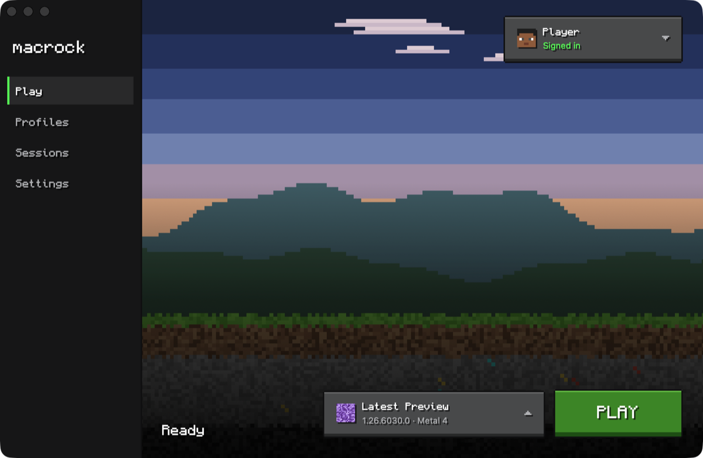

# macrock

Play the Windows edition of Minecraft: Bedrock Edition on Apple Silicon Macs.

macrock is a macOS app that installs, updates and starts the game for one or more Microsoft
accounts. It runs the game on [macrock-engine](https://github.com/vincenzopio/macrock-engine):
Wine with a few patches, the Xbox GDK runtime the game expects, and a service for the Microsoft
account. Apple's D3DMetal draws the game with Metal.

> [!WARNING]
> Experimental. Not affiliated with Mojang, Microsoft or Apple.

> [!NOTE]
> macrock never ships the game or D3DMetal. The game comes from Microsoft with your account.
> D3DMetal comes from Apple's Game Porting Toolkit, which you download yourself.



## Features

- **Accounts.** Sign in with more than one Microsoft account. Each has its own credentials, Wine
  prefix and game data.
- **The game.** macrock downloads Minecraft and Minecraft Preview from Microsoft and keeps them up
  to date. An update can keep the version it replaces, to play later; its worlds are backed up
  before it plays.
- **Profiles.** A version of the game with its own settings: Metal 4 or Metal 3, msync, Retina
  mode, the Metal HUD and a log of frame rates.
- **Contents.** The worlds and packs of each account. Open a `.mcworld`, `.mcpack` or `.mcaddon`
  from the Finder, or drop it on the window.
- **For creators.** The `com.mojang` folders and a `.env` for Regolith, Minecraft's Editor, the
  content log, and the script debugger of Mojang's VS Code extension.
- **Sessions.** The logs of every game session.

What works inside the game is listed in macrock-engine's
[Status](https://github.com/vincenzopio/macrock-engine#status) and
[known issues](https://github.com/vincenzopio/macrock-engine/blob/main/docs/known-issues.md).

## Requirements

- A Mac with Apple Silicon, macOS 27 and Rosetta 2. macrock offers to install Rosetta 2.
- About 8 GB of free space for the engine and the game.
- Apple's Game Porting Toolkit 4, from
  [Apple's developer downloads](https://developer.apple.com/download/all/?q=game%20porting%20toolkit).
  It needs an Apple Account.
- A Microsoft account that owns Minecraft for Windows.

## Install

1. Download macrock from the [Releases](https://github.com/vincenzopio/macrock/releases) and move
   it to Applications.
2. Open it. macrock is not notarized, so macOS refuses it the first time: open System Settings ›
   Privacy & Security and choose Open Anyway.
3. Follow the first-run steps: sign in, install the game, and drop the Game Porting Toolkit disk
   image on the window. macrock shows Apple's license and copies D3DMetal as Apple made it.

After an update that brings a new build of the account service, macOS asks for your login
password once per account. Choose Always Allow.

## How it works

```
macrock.app                        the launcher, native arm64
 ├─ xodus-service                  one per account: sign-in, credentials, game downloads
 └─ macrock-engine                 downloaded from its GitHub releases
     └─ Wine → Minecraft.Windows.exe   x86_64 under Rosetta 2, drawn by D3DMetal
```

- An account's credentials live in one Keychain item that only its account service reads. The
  launcher never reads them.
- The account service answers only a launcher signed with the same certificate.
- The sign-in page's result goes from the page straight to the account service, never to disk.
- The game's executable must carry Microsoft's signature. The engine must match the SHA-256 and
  the code directory hash of its release, and its seal is checked before every session.

## Build

You need macOS 27 on Apple Silicon, Xcode 27 and the [GitHub CLI](https://cli.github.com).

```sh
scripts/signing-identity.sh      # once: create the signing identity "macrock Local"
scripts/vendor-engine.sh 0.2.0   # take the account service of an engine release
xcodebuild -project launcher.xcodeproj -scheme launcher -configuration Release build
```

`signing-identity.sh` creates a self-signed certificate in your login keychain. The app and its
account service are signed with it, and nothing leaves the Mac. `vendor-engine.sh --from <dir>`
takes the release from a folder instead of GitHub.

The tests run with `swift test --package-path LauncherCore`. Two variables turn on the tests that
need files macrock cannot ship:

- `MACROCK_GPTK_IMAGE`: the Game Porting Toolkit disk image;
- `MACROCK_GAME_FOLDER`: an installed game folder.

## Repository

```
launcher/       the app: SwiftUI views and their theme
LauncherCore/   a Swift package with everything else, and its tests
Config/         build settings and the file types macrock opens
scripts/        the signing identity, the account service, its protocol messages
```

## Credits

- [macrock-engine](https://github.com/vincenzopio/macrock-engine), and Wine, xgameruntime and
  Xodus beneath it.
- [Xodus](https://github.com/xodus-gaming/xodus): the account service.
- [Monocraft](https://github.com/IdreesInc/Monocraft) by Idrees Hassan: the pixel font.
- [BedrockOnLinux](https://github.com/Wyze3306/BedrockOnLinux): how to install GameInput from the
  game's own package.
- [SwiftProtobuf](https://github.com/apple/swift-protobuf): the messages to the account service.
- Apple's Game Porting Toolkit provides D3DMetal. It is not distributed here.

## License

macrock is free software under the GNU General Public License, version 3 or later
([LICENSE](LICENSE)). The app carries xodus-service, which is GPL-3.0-only, so the app as a whole
is distributed under GPL-3.0. Minecraft is a trademark of Mojang Synergies AB.
